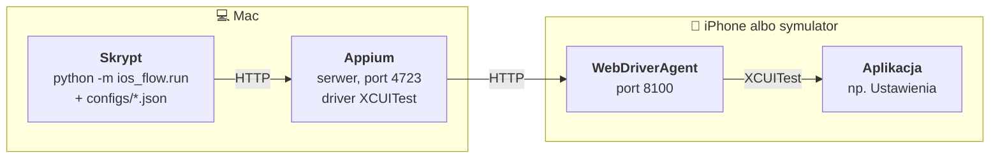
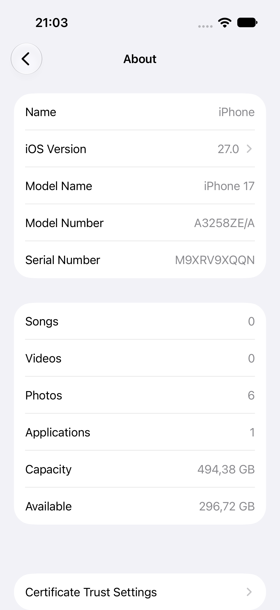

<h1 align="center">iOS Flow Runner</h1>
<p align="center">
  <em>Developed, maintained and generously sponsored by
  <a href="https://github.com/chlebekzszynka">chlebek z szynką</a> 🥪</em>
</p>
<p align="center">
  
  
  
</p>

Framework do automatyzacji aplikacji iOS przez Appium, w którym cała ścieżka nawigacji siedzi w pliku JSON, a kod nie zna żadnej konkretnej aplikacji.
Dołączony przykład działa na symulatorze iPhone'a od razu — bez konta Apple Developer, bez podpisywania i bez fizycznego telefonu. Testy (131) działają bez urządzenia, na zapisanych drzewach elementów.

## Spis treści

1. [Co to jest](#1-co-to-jest)
2. [Jak to działa](#2-jak-to-działa)
3. [Szybki start na symulatorze](#3-szybki-start-na-symulatorze)
4. [Wariant z telefonem fizycznym](#4-wariant-z-telefonem-fizycznym)
5. [Konfiguracja](#5-konfiguracja)
6. [Własna aplikacja](#6-własna-aplikacja)
7. [Decyzje projektowe](#7-decyzje-projektowe)
8. [Problemy i jak je rozwiązałem](#8-problemy-i-jak-je-rozwiązałem)
9. [Testy](#9-testy)
10. [Jak to powstało](#10-jak-to-powstało)
11. [Struktura projektu](#11-struktura-projektu)

---

## 1. Co to jest

Framework, który steruje dowolną aplikacją iOS **z zewnątrz** — tak jak
człowiek palcem: dotyka przycisków, przechodzi przez ekrany, czyta teksty
i zapisuje wynik do pliku JSON razem ze zrzutem ekranu. Nie potrzebuje
dostępu do kodu źródłowego aplikacji.

Cała wiedza o konkretnej aplikacji — którędy iść i w co dotykać — siedzi
w pliku konfiguracyjnym JSON. Kod frameworka nie zna żadnej aplikacji.
Nowa aplikacja to nowy plik w `configs/`, bez zmian w Pythonie.

Dołączony przykład otwiera **Ustawienia** na symulatorze iPhone'a, wchodzi
w Ogólne → To urządzenie, odczytuje wersję iOS, nazwę urządzenia i model,
po czym zapisuje je do JSON-a ze znacznikiem czasu i zrzutem ekranu.
Ustawienia są wbudowane w system, więc przykład działa na każdym Macu
z Xcode — bez konta Apple Developer, bez podpisywania i bez telefonu.

**Dlaczego nie czysty XCUITest?** XCUITest to natywny framework Apple do
testów interfejsu. Testy pisze się w Swifcie jako część projektu Xcode
aplikacji, więc trzeba mieć jej kod źródłowy i budować ją samemu. Tutaj
sterujemy aplikacją, której kodu nie mamy (w przykładzie — systemowymi
Ustawieniami), z Pythona, a ścieżkę zmieniamy edycją JSON-a, bez
kompilowania czegokolwiek. Appium daje właśnie to: XCUITest pod spodem,
dowolny język i dowolna aplikacja na wierzchu.

## 2. Jak to działa



1. **Skrypt** (`ios_flow`) czyta konfigurację i wysyła polecenia w rodzaju
   „znajdź element o identyfikatorze X” i „dotknij go”.
2. **Appium** — serwer na Macu, nasłuchuje na porcie **4723**. Tłumaczy
   polecenia na wywołania konkretnego drivera; dla iOS to driver
   **XCUITest**.
3. **WebDriverAgent (WDA)** — osobna aplikacja instalowana na urządzeniu
   (albo symulatorze), nasłuchuje na porcie **8100**. To jedyny element,
   który faktycznie dotyka ekranu i czyta jego zawartość, używając
   XCUITest od środka.
4. **Aplikacja** — ta, którą sterujemy. Nic o tym nie wie.

WDA jest budowane i podpisywane przez Xcode, a Xcode działa tylko na
macOS — **stąd wymóg Maca**. Na symulatorze Appium buduje WDA samo, bez
podpisywania. Na telefonie WDA trzeba podpisać własnym kontem Apple
Developer (rozdział 4).

Więcej o roli każdego elementu: [docs/architektura.md](docs/architektura.md).

## 3. Szybki start na symulatorze

Ścieżka główna: od czystego Maca do pierwszego przebiegu.

**Potrzebujesz:** Maca z **Xcode** (z App Store; przy pierwszym uruchomieniu
Xcode doinstaluje komponenty i środowisko symulatora iOS) oraz
**Homebrew** ([brew.sh](https://brew.sh)).

Sprawdzone na: macOS 26.7, Xcode 27.0, symulator iPhone 17 z iOS 27.0,
Appium 3.8.0, driver xcuitest 12.15.0, Python 3.14.

### Krok 1. Node.js

```bash
brew install node
```

**Sukces:** `node --version` wypisuje numer wersji, np. `v26.10.0`.

### Krok 2. Appium

```bash
npm i -g appium
```

**Sukces:** `appium --version` wypisuje numer wersji, np. `3.8.0`.

### Krok 3. Driver XCUITest

```bash
appium driver install xcuitest
```

**Sukces:** `appium driver list --installed` pokazuje wiersz w rodzaju
`- xcuitest@12.15.0 [installed (npm)]`.

### Krok 4. Wybór symulatora

```bash
xcrun simctl list devices available
```

**Sukces:** lista urządzeń pogrupowana według wersji iOS, np.:

```
== Devices ==
-- iOS 27.0 --
    iPhone 17 (F27C7A0A-...) (Shutdown)
```

Zapamiętaj **nazwę** urządzenia (`iPhone 17`) i **wersję** z nagłówka
sekcji (`27.0`). Jeśli różnią się od tych w
[`configs/przyklad-symulator.json`](configs/przyklad-symulator.json),
popraw w tym pliku pola `symulator.nazwa_urzadzenia` i `symulator.wersja_ios`.

Pusta lista oznacza, że Xcode nie ma jeszcze środowiska iOS: Xcode →
Settings → Components i pobierz platformę iOS.

### Krok 5. Uruchomienie symulatora

```bash
xcrun simctl boot "iPhone 17"
open -a Simulator
```

**Sukces:** otwiera się okno Simulator z ekranem głównym iPhone'a.
(`Unable to boot device in current state: Booted` znaczy, że już działa —
też dobrze.)

### Krok 6. Serwer Appium

W **osobnym** terminalu, który zostaw otwarty:

```bash
appium
```

**Sukces:** wśród komunikatów są wiersze:

```
[Appium] Appium REST http interface listener started on http://0.0.0.0:4723
[Appium] Available drivers:
[Appium]   - xcuitest@12.15.0 (automationName 'XCUITest')
```

### Krok 7. Środowisko Pythona

Potrzebny Python **3.11 lub nowszy** (`python3 --version`; systemowy
`python3` z narzędzi Xcode bywa starszy — wtedy `brew install python`).
W katalogu projektu:

```bash
python3 -m venv .venv
source .venv/bin/activate
pip install -r requirements.txt
```

**Sukces:** znak zachęty zaczyna się od `(.venv)`, a `pip` kończy
komunikatem `Successfully installed ...` bez błędów.

### Krok 8. Sprawdzenie konfiguracji

```bash
python -m ios_flow.run configs/przyklad-symulator.json --sprawdz
```

**Sukces:** bez łączenia z czymkolwiek wypisuje
`Konfiguracja configs/przyklad-symulator.json jest poprawna (tryb: symulator).`
i listę capabilities, które pójdą do Appium (m.in. `"appium:deviceName": "iPhone 17"`).

### Krok 9. Pierwszy przebieg

```bash
python -m ios_flow.run configs/przyklad-symulator.json
```

Pierwsze uruchomienie trwa dłużej: Appium buduje i instaluje
WebDriverAgent na symulatorze. Kolejne startują w kilka sekund.

**Sukces:** na symulatorze otwierają się Ustawienia, potem Ogólne i To
urządzenie, a w terminalu:

```
[18:27:52] Przepływ: Ustawienia: informacje o urządzeniu (tryb: symulator)
[18:27:52] Łączę z Appium: http://127.0.0.1:4723
[18:27:59] Sesja otwarta
[18:27:59] Restartuję aplikację
[18:28:07] Krok 1/2: Ogólne
[18:28:09] Krok 2/2: To urządzenie
[18:28:11] Pole „wersja_systemu”: 27.0
[18:28:11] Pole „nazwa_urzadzenia”: iPhone
[18:28:11] Pole „model”: iPhone 17
[18:28:12] Zrzut ekranu: artifacts/przyklad-symulator_20261021_182752.png
[18:28:12] Zapisano: artifacts/przyklad-symulator_20261021_182752.json
[18:28:12] Sesja zamknięta
```

Plik wynikowy (skrócony):

```json
{
  "przeplyw": "Ustawienia: informacje o urządzeniu",
  "tryb": "symulator",
  "aplikacja": "com.apple.Preferences",
  "rozpoczeto": "2026-10-21T18:27:59+02:00",
  "odczyt": {
    "wersja_systemu": "27.0",
    "nazwa_urzadzenia": "iPhone",
    "model": "iPhone 17"
  },
  "surowe": {
    "wersja_systemu": "iOS Version, 27.0",
    "nazwa_urzadzenia": "Name, iPhone",
    "model": "Model Name, iPhone 17"
  },
  "kroki": [
    { "opis": "Ogólne", "wynik": "kliknięty" },
    { "opis": "To urządzenie", "wynik": "kliknięty" }
  ],
  "teksty_na_ekranie": ["About", "Name", "iPhone", "iOS Version", "27.0", "..."],
  "zrzut_ekranu": "artifacts/przyklad-symulator_20261021_182752.png",
  "zakonczono": "2026-10-21T18:28:12+02:00"
}
```

<p align="center">
  
</p>
<p align="center">
  <sub>Zrzut zapisany automatycznie na końcu przebiegu — to z tego ekranu
  pochodzą wartości w <code>odczyt</code>.</sub>
</p>

`odczyt` to wartości wyciągnięte wzorcem, `surowe` — pełny tekst elementu
(do diagnozy, gdy wzorzec nie pasuje). Etykiety są po angielsku, bo taki
jest domyślny język symulatora; przykład działa w każdym języku, bo
nawiguje po identyfikatorach, nie po napisach.

**Kody wyjścia:** `0` — sukces; `1` — błąd (konfiguracja, sesja,
nawigacja); `2` — przebieg doszedł do końca, ale nie wszystkie pola
udało się odczytać (JSON i tak jest zapisany, z `null` w brakujących polach).

### Dodatkowo: lista z przewijaniem

```bash
python -m ios_flow.run configs/przyklad-symulator.json --lista
```

Zamiast pojedynczych pól zbiera wszystkie wiersze ekranu To urządzenie
(nazwa + wartość), przewijając w dół, aż dwa kolejne przewinięcia nie
przyniosą nic nowego. **Sukces:** w logu wiersze
`Ekran 1: nowych pozycji 11, łącznie 11` i lista `Name: iPhone`,
`iOS Version: 27.0`, … zapisana w polu `lista` pliku wynikowego.

## 4. Wariant z telefonem fizycznym

Na prawdziwym iPhonie WebDriverAgent musi być podpisany Twoim
certyfikatem, bo iOS nie uruchomi niepodpisanej aplikacji.

### Konto Apple Developer

| Konto | Ważność certyfikatu | Uwagi |
|---|---|---|
| Darmowe (dowolny Apple ID) | **7 dni** | Po tygodniu WDA przestaje się uruchamiać — trzeba podpisać ponownie |
| Płatne Organization, 99 USD/rok | **1 rok** | Do pracy ciągłej |

Dodaj konto w Xcode: Xcode → Settings → Accounts → `+` → Apple ID.

### Narzędzia do komunikacji z telefonem

```bash
brew install libimobiledevice ideviceinstaller
```

**Sukces:** po podłączeniu telefonu kablem i zaakceptowaniu na nim
„Zaufaj temu komputerowi” `idevice_id -l` wypisuje identyfikator (UDID).

### Przygotowanie telefonu

Nazwy menu podane są w angielskiej wersji iOS.

1. **Tryb programisty:** Settings → Privacy & Security → Developer Mode →
   włącz (telefon się zrestartuje).
2. **Autoblokada na Nigdy:** Settings → Display & Brightness → Auto-Lock →
   Never. Zablokowany ekran przerywa sesję.

### Podpisanie WebDriverAgent

```bash
appium driver run xcuitest open-wda
```

Otwiera projekt WebDriverAgent w Xcode. Tam:

1. Wybierz cel **WebDriverAgentRunner** → zakładka *Signing & Capabilities*.
2. *Team*: Twoje konto.
3. *Bundle Identifier*: zmień na unikalny, np.
   `com.twojanazwa.WebDriverAgentRunner`. Ta wartość to później
   `urzadzenie.wda_bundle_id` w konfiguracji.
4. U góry wybierz swój telefon jako urządzenie docelowe i uruchom
   Product → Test (**Cmd+U**). Przy pierwszym razie zaufaj certyfikatowi na
   telefonie: Settings → General → VPN & Device Management.
5. **Zatrzymaj test w Xcode** (Cmd+.). Od teraz WDA uruchamia Appium,
   a dwie działające instancje WDA walczą o port 8100 (patrz rozdział 8).

### Konfiguracja i przebieg

```bash
cp configs/szablon-urzadzenie.json configs/moj-telefon.local.json
python -m ios_flow.run configs/moj-telefon.local.json --sprawdz
```

Pliki `*.local.json` są w `.gitignore` — Twój UDID i Team ID nie trafią do
repozytorium. Walidacja wypisze, których pól brakuje i skąd je wziąć:

```
Konfiguracja configs/moj-telefon.local.json ma błędy (3):
  - urzadzenie.udid: brak wartości. Skąd wziąć: idevice_id -l (telefon podłączony kablem i odblokowany)
  - urzadzenie.team_id: brak wartości. Skąd wziąć: security find-identity -v -p codesigning — 10 znaków w nawiasie na końcu wiersza
  - urzadzenie.wda_bundle_id: brak wartości. Skąd wziąć: Bundle Identifier ustawiony w Xcode dla celu WebDriverAgentRunner
```

Po uzupełnieniu: `python -m ios_flow.run configs/moj-telefon.local.json`.

## 5. Konfiguracja

Plik JSON. Klucze zaczynające się od `_` to komentarze — framework je
pomija. Nieznane klucze są zgłaszane jako błąd (łapie literówki).

### Dwa tryby

Pole `tryb` decyduje, które capabilities pójdą do Appium:

| | `"tryb": "symulator"` | `"tryb": "urzadzenie"` |
|---|---|---|
| Sekcja wymagana | `symulator` | `urzadzenie` |
| Wysyłane | `deviceName`, `platformVersion` | `udid`, `xcodeOrgId`, `xcodeSigningId`, `updatedWDABundleId` |
| Niewysyłane | `udid`, `xcodeOrgId`, `xcodeSigningId`, `updatedWDABundleId` | `deviceName` |
| W obu | `waitForQuiescence: false`, `snapshotMaxDepth`, `newCommandTimeout`, `bundleId`, `noReset: true` | |

Podgląd tego, co faktycznie zostanie wysłane: `--sprawdz`.

### Pola główne

| Pole | Wymagane | Opis | Skąd wziąć |
|---|---|---|---|
| `nazwa` | nie | Nazwa przepływu w logach i wyniku | dowolna |
| `tryb` | tak | `symulator` albo `urzadzenie` | |
| `serwer_appium` | nie | Adres Appium, domyślnie `http://127.0.0.1:4723` | |
| `bundle_id` | tak | Identyfikator sterowanej aplikacji | symulator: `xcrun simctl listapps booted`; telefon: `ideviceinstaller list` |

### `symulator`

| Pole | Opis | Skąd wziąć |
|---|---|---|
| `nazwa_urzadzenia` | np. `iPhone 17` | `xcrun simctl list devices available` |
| `wersja_ios` | np. `27.0` | nagłówek sekcji w tej samej liście: `-- iOS 27.0 --` |

### `urzadzenie`

| Pole | Opis | Skąd wziąć |
|---|---|---|
| `udid` | Identyfikator telefonu | `idevice_id -l` |
| `team_id` | Identyfikator zespołu do podpisania WDA (`xcodeOrgId`) | `security find-identity -v -p codesigning` — 10 znaków w nawiasie |
| `signing_id` | Typ certyfikatu (`xcodeSigningId`) | zwykle `Apple Development` |
| `wda_bundle_id` | Bundle ID podpisanego WDA (`updatedWDABundleId`) | to, co wpisałeś w Xcode dla WebDriverAgentRunner |

### `sesja` (cała opcjonalna)

| Pole | Domyślnie | Opis |
|---|---|---|
| `snapshot_max_depth` | `50` | Jak głęboko czytać drzewo elementów (rozdział 8) |
| `new_command_timeout` | `300` | Po ilu sekundach bezczynności Appium zamyka sesję |
| `restart_aplikacji` | `true` | Zamknij i otwórz aplikację przed krokami — każdy przebieg startuje z tego samego miejsca |
| `dodatkowe_capabilities` | `{}` | Dowolne capabilities Appium; bez przedrostka dostają `appium:`, np. `{"showXcodeLog": true}` |

### `kroki` — ścieżka nawigacji

Lista kroków wykonywanych po kolei. Każdy: znajdź element, dotknij go.

```json
{
  "opis": "To urządzenie",
  "lokator": { "typ": "id", "wartosc": "com.apple.settings.general.about", "element": "Button" },
  "czekaj_s": 10,
  "pauza_s": 1.0,
  "opcjonalny": false
}
```

| Pole | Domyślnie | Opis |
|---|---|---|
| `opis` | wartość lokatora | Nazwa kroku w logach |
| `lokator` | — | Jak znaleźć element (niżej) |
| `czekaj_s` | `10` | Ile sekund czekać na pojawienie się elementu |
| `pauza_s` | `1.0` | Pauza po dotknięciu, na animację przejścia |
| `opcjonalny` | `false` | `true`: brak elementu pomija krok zamiast przerywać przebieg |

### `lokator`

| Pole | Opis |
|---|---|
| `typ` | `id` — atrybut `name` (identyfikator dostępności); `etykieta` — atrybut `label`; `predykat` — surowy predykat iOS; `class_chain`; `xpath` |
| `wartosc` | Szukany tekst. Może zawierać `{zmienna}` (typy `id`, `etykieta`, `predykat`) |
| `element` | Opcjonalny typ elementu: `Button`, `Cell`, `StaticText`… |
| `z_dopiskiem` | Tylko `etykieta`: `true` dopuszcza dalszą część po przecinku — `Name` trafi w `Name, iPhone`, ale nie w `NameX` |
| `przedrostki_stanu` | Tylko `etykieta`: np. `["Selected"]` — trafi też w `Selected, X` |

`id` i `etykieta` zawsze dają **dokładne** dopasowanie (`==`). Apostrofy
i backslashe w wartości są zabezpieczane automatycznie.

`{zmienna}` wypełnia się z wiersza poleceń:
`python -m ios_flow.run moja.json --zmienna "Keyboard"`. Może wystąpić
najwyżej w jednym kroku.

### `odczyt` — co odczytać na ostatnim ekranie

```json
"odczyt": {
  "wersja_systemu": {
    "lokator": { "typ": "id", "wartosc": "SW_VERSION_SPECIFIER", "element": "Button" },
    "atrybut": "label",
    "wzorzec": "^[^,]+,\\s*(?P<wartosc>.+)$"
  }
}
```

| Pole | Domyślnie | Opis |
|---|---|---|
| `lokator` | — | Element z wartością |
| `atrybut` | `label` | `label`, `value` albo `name` |
| `wzorzec` | brak (cały tekst) | Wyrażenie regularne; wynik to grupa `(?P<wartosc>...)`, a bez niej pierwsza grupa albo całe dopasowanie. W JSON-ie backslash podwójnie: `\\s` |
| `czekaj_s` | `10` | Ile czekać na element |

### `lista` — dla `--lista`

| Pole | Domyślnie | Opis |
|---|---|---|
| `element` | `Button` | Typ elementów będących pozycjami |
| `nazwa_elementu` | brak | Dokładny `name` pozycji, gdy lista ma wspólny identyfikator |
| `wzorzec` | brak | Wyrażenie z grupami `(?P<nazwa>...)` i `(?P<wartosc>...)` |
| `tylko_pasujace` | `false` | `true`: pomiń elementy niepasujące do wzorca (np. przycisk Wstecz) |
| `przedrostki_stanu` | `[]` | Zdejmowane z etykiety i zapisywane w polu `stan` |
| `pomijaj_zawierajace` | `[]` | Fragmenty tekstów pomocniczych dla czytnika ekranu — takie elementy są pomijane |
| `max_przewiniec` | `20` | Górny limit przewinięć |

Jeśli któryś krok zawiera `{zmienna}`, lista jest zbierana na ekranie
**przed** tym krokiem — tak można najpierw sprawdzić, jakie wartości są
dostępne, a potem uruchomić przebieg z `--zmienna`.

### `wynik`

| Pole | Domyślnie | Opis |
|---|---|---|
| `katalog` | `artifacts` | Gdzie zapisać JSON i zrzut ekranu (`--wynik plik.json` nadpisuje ścieżkę JSON-a) |
| `zrzut_ekranu` | `true` | Czy robić zrzut na końcu |

## 6. Własna aplikacja

1. **Znajdź bundle ID**: `xcrun simctl listapps booted` (symulator) albo
   `ideviceinstaller list` (telefon).
2. **Załóż konfigurację**: skopiuj przykład albo szablon do
   `configs/moja-aplikacja.local.json`, wpisz `bundle_id`, wyczyść `kroki`
   i `odczyt`.
3. **Mapuj ekran po ekranie.** Ręcznie przejdź w aplikacji na pierwszy
   ekran ścieżki i uruchom podgląd:

   ```bash
   python -m ios_flow.inspect configs/moja-aplikacja.local.json
   ```

   Podgląd nie restartuje aplikacji — pokazuje to, co widać teraz.
   Tak wygląda wynik dla ekranu Ustawienia → Ogólne:

   ```
   #   TYP          NAME (identyfikator)                 LABEL (etykieta)               VALUE
   ----------------------------------------------------------------------------------------------------
   1   Button       BackButton                           Settings
   2   Button       com.apple.settings.general.about     About
   3   Button       com.apple.settings.general.keyboard  Keyboard
   4   Button       com.apple.settings.general.language… Language & Region
   
   Razem: 4. Propozycje lokatorów do pliku konfiguracyjnego:
   1   "lokator": {"typ": "id", "wartosc": "BackButton", "element": "Button"}
   2   "lokator": {"typ": "id", "wartosc": "com.apple.settings.general.about", "element": "Button"}
   3   "lokator": {"typ": "id", "wartosc": "com.apple.settings.general.keyboard", "element": "Button"}
   4   "lokator": {"typ": "id", "wartosc": "com.apple.settings.general.languageAndRegion", "element": "Button"}
   ```

   Przydatne flagi: `--szukaj tekst` (filtr), `--wszystkie` (także teksty
   i kontenery), `--zapisz-xml ekran.xml` (całe drzewo do pliku).
4. **Wybierz lokator.** Kolejność preferencji: `id` (jeśli `name` różni
   się od etykiety — zwykle nadał go programista i nie zależy od języka),
   potem `etykieta`, potem `predykat`. `class_chain` i `xpath` w ostateczności.
5. **Dopisz krok** do `kroki`, dotknij elementu ręcznie, powtórz od punktu 3
   dla następnego ekranu.
6. **Na ostatnim ekranie** dopisz pola do `odczyt`.
7. **Sprawdź:** `--sprawdz`, potem pełny przebieg. Przy błędzie nawigacji
   w `artifacts/` zostają `*_blad.png` i `*_blad.xml` z chwili błędu.

Elementy, które pojawiają się tylko czasem (okienko z prośbą o ocenę,
baner, inny wariant ekranu), dodaj jako krok z `"opcjonalny": true`
i krótkim `czekaj_s`.

Szczegółowa procedura (dla ludzi i dla Claude Code) jest w
[.claude/skills/namierzanie-lokatorow/SKILL.md](.claude/skills/namierzanie-lokatorow/SKILL.md).

## 7. Decyzje projektowe

**Appium zamiast XCUITest.** XCUITest wymaga kodu źródłowego aplikacji
i pisania testów w Swifcie wewnątrz jej projektu Xcode. Appium używa
XCUITest pod spodem (przez WebDriverAgent), ale steruje z zewnątrz
dowolną zainstalowaną aplikacją, z dowolnego języka. Cena: dodatkowe
warstwy (serwer, WDA) i wolniejsze wykonanie — przy automatyzacji kilku
ekranów nieistotne.

**Lokatory w konfiguracji, nie w kodzie.** Identyfikatory i napisy
zmieniają się z każdą wersją aplikacji, a kod frameworka — rzadko. Gdy
lokatory są w JSON-ie, aktualizacja po zmianie w aplikacji to edycja
jednego pliku, bez ryzyka zepsucia logiki i bez nowego wydania. Ten sam
kod obsługuje dowolną liczbę aplikacji.

**Kroki opcjonalne zamiast osobnej ścieżki na każdy wariant.** Aplikacje
pokazują ten sam ekran w kilku wariantach: raz z okienkiem, raz bez,
z innym przyciskiem w zależności od stanu. Osobna ścieżka na każdą
kombinację mnoży konfiguracje. Jedna ścieżka z krokami oznaczonymi
`opcjonalny` przechodzi przez wszystkie warianty: brakujący element jest
pomijany, a brak elementu w kroku obowiązkowym nadal przerywa przebieg.

**Dopasowanie dokładne.** Częściowe (`CONTAINS`) trafia w warianty:
`20%` pasuje też do `20%HM` i `20%VM`. Appium zwraca pierwszy pasujący
element, więc przebieg dotyka nie tego, co trzeba, i nie zgłasza błędu —
najgorszy rodzaj awarii. Dokładne dopasowanie albo trafia, albo głośno
zawodzi. Etykiety z dopiskiem obsługuje `z_dopiskiem`, które wymaga
pełnego członu przed przecinkiem.

**CI bez symulatora.** CI uruchamia `pytest` i `ruff check` na Ubuntu bez
symulatora i bez Appium, bo start symulatora przez Appium na hostowanych
maszynach macOS GitHuba jest zawodny, a wszystkie testy i tak działają na
zapisanych drzewach XML — przebieg end-to-end uruchamia się lokalnie na
Macu. Czerwony build ma znaczyć „zepsuty kod”, nie „maszyna CI miała zły
dzień”.

## 8. Problemy i jak je rozwiązałem

### `socket hang up`

**Objaw:** sesja nie wstaje, Appium zgłasza `socket hang up` przy
łączeniu z WebDriverAgent.
**Przyczyna:** dwie instancje WDA walczą o port 8100 — typowo jedna
uruchomiona testem z Xcode (Cmd+U przy podpisywaniu), druga przez Appium.
**Rozwiązanie:** zatrzymaj test w Xcode (Cmd+.) i uruchom przebieg
ponownie. Od momentu podpisania WDA uruchamia wyłącznie Appium.

### `xcodebuild failed with code 65`

**Objaw:** sesja na telefonie kończy się ogólnym błędem budowania WDA
z kodem 65, bez szczegółów.
**Przyczyna:** WDA nie dało się zbudować albo podpisać; kod 65 to tylko
„coś poszło nie tak” w `xcodebuild`.
**Rozwiązanie:** włącz pełny log budowania w konfiguracji:

```json
"sesja": { "dodatkowe_capabilities": { "showXcodeLog": true } }
```

Appium wypisze wtedy cały log `xcodebuild` z właściwą przyczyną
(najczęściej podpis: zły Team, zajęty Bundle Identifier, wygasły
certyfikat). Napraw w Xcode na celu WebDriverAgentRunner (rozdział 4).

### Sesja wisi na starcie

**Objaw:** `Łączę z Appium` i nic — sesja nie otwiera się albo pierwszy
krok trwa w nieskończoność.
**Przyczyna:** domyślnie XCUITest przed każdą akcją czeka, aż aplikacja
przestanie animować (stan wyciszenia). Aplikacja z animacjami, mapą albo
odtwarzaczem nigdy go nie osiąga.
**Rozwiązanie:** `waitForQuiescence: false` — framework ustawia to zawsze,
w obu trybach. W zamian czekamy jawnie na konkretny element (`czekaj_s`)
i robimy krótką pauzę po dotknięciu (`pauza_s`).

### Puste drzewo elementów

**Objaw:** `inspect` pokazuje „Nic nie znalazłem” albo same kontenery
`Other`, choć na ekranie widać przyciski.
**Przyczyna:** (a) ekran jeszcze się nie narysował w chwili zrzutu,
albo (b) drzewo jest głębsze niż limit `snapshotMaxDepth` i XCUITest
ucina je na samych kontenerach.
**Rozwiązanie:** (a) odczekaj chwilę i powtórz; (b) podnieś
`sesja.snapshot_max_depth` (domyślnie 50).

### Dopasowanie częściowe trafia w niewłaściwy wariant

**Objaw:** przebieg przechodzi bez błędu, ale otwiera nie tę pozycję
listy — np. `20%HM` zamiast `20%`.
**Przyczyna:** predykat `label CONTAINS '20%'` pasuje do kilku elementów,
a Appium bierze pierwszy.
**Rozwiązanie:** framework buduje wyłącznie dokładne dopasowania (`==`
oraz `BEGINSWITH '<tekst>, '` dla `z_dopiskiem`). Pilnują tego testy
w `tests/test_locators.py` na fiksturze z wariantami.

### Element ładuje się wolniej niż reszta ekranu

**Objaw:** krok zgłasza brak elementu albo pole ma `null`, choć po chwili
element jest widoczny; w `teksty_na_ekranie` go brak.
**Przyczyna:** część ekranu dochodzi później (dane z sieci, wolniej
generowana grafika). Zrzut drzewa zrobiony zaraz po przejściu na ekran
jeszcze jej nie zawiera.
**Rozwiązanie:** dla tego kroku lub pola podnieś `czekaj_s` — framework
czeka na konkretny element, a nie stały czas. Drzewo do
`teksty_na_ekranie` pobiera dopiero **po** znalezieniu pól docelowych,
więc zawiera także te spóźnione elementy.

### Certyfikat darmowego konta wygasa po 7 dniach

**Objaw:** na telefonie działało, po tygodniu sesja nie wstaje albo WDA
nie uruchamia się na telefonie.
**Przyczyna:** darmowe konto Apple daje certyfikat ważny 7 dni; po tym
czasie podpis WDA jest nieważny.
**Rozwiązanie:** podpisz WDA ponownie (rozdział 4: Cmd+U w Xcode, potem
zatrzymaj test). Na stałe: płatne konto Organization (99 USD/rok)
z certyfikatem na rok.

## 9. Testy

```bash
source .venv/bin/activate
pytest -v
ruff check .
```

**Sukces:** `131 passed`, `All checks passed!`.

Testy **nie potrzebują** urządzenia, symulatora ani serwera Appium.
Działają na zapisanych drzewach elementów w
[`tests/fixtures/`](tests/fixtures/) — plikach XML w formacie, jaki
zwraca Appium, odwzorowujących ekrany Ustawień. Atrapa urządzenia
(`FakeDevice` w `tests/conftest.py`) przechodzi między nimi po
„dotknięciu” elementu, więc cały przebieg — od restartu aplikacji przez
kroki do zapisu JSON-a — jest sprawdzany offline.

Co to daje: testy trwają sekundy, działają na każdym systemie (CI na
Ubuntu), a ich wynik zależy wyłącznie od kodu, nie od stanu symulatora.
Pokrywają m.in. parsowanie wartości, dokładne dopasowanie i
zabezpieczanie apostrofów, przedrostki stanu, elementy dla czytnika
ekranu, scalanie przewinięć, kroki opcjonalne i zmienne, capabilities obu
trybów i komunikaty walidacji.

Nowa logika parsowania = nowa fikstura + test. Opis fikstur:
[tests/fixtures/README.md](tests/fixtures/README.md).

## 10. Jak to powstało

Projekt napisałem we współpracy z Claude Code. W repozytorium zostały po tym
ślady, których używam na co dzień:

- **[CLAUDE.md](CLAUDE.md)** — zasady projektu i pułapki techniczne wraz
  z uzasadnieniem. Każda sesja zaczyna z czystym kontekstem, więc wiedza
  o projekcie musi być zapisana, a nie opowiedziana.
- **[.claude/skills/namierzanie-lokatorow](.claude/skills/namierzanie-lokatorow/SKILL.md)**
  — procedura mapowania nowego ekranu, spisana raz i wykonywana tak samo
  przez człowieka i przez agenta.
- **[.claude/commands/chlebek.md](.claude/commands/chlebek.md)** — `/chlebek`:
  kontrola przed wydaniem (testy, lint, audyt sekretów, wpis w CHANGELOG).
- **[.claude/agents/recenzent.md](.claude/agents/recenzent.md)** — przegląd
  zmian pod kątem reguł projektu: czy lokator nie wyciekł do kodu, czy nowa
  logika ma test, czy komunikat błędu mówi użytkownikowi, co zrobić.

Decyzje projektowe z rozdziału 7 i rozwiązania z rozdziału 8 wzięły się
z realnych awarii napotkanych przy budowie, nie z lektury dokumentacji.

## 11. Struktura projektu

```
ios-flow-runner/
├── README.md                      ten plik
├── CLAUDE.md                      zasady projektu i pułapki dla Claude Code
├── CHANGELOG.md                   historia wydań
├── LICENSE                        MIT
├── pyproject.toml                 konfiguracja ruff i pytest
├── requirements.txt               zależności (Appium-Python-Client, pytest, ruff)
├── .github/workflows/tests.yml    CI: pytest + ruff, Python 3.11 i 3.13
├── .claude/
│   ├── commands/chlebek.md        /chlebek — kontrola przed wydaniem
│   ├── skills/namierzanie-lokatorow/SKILL.md   procedura mapowania ekranu
│   └── agents/recenzent.md        podagent przeglądu zmian
├── configs/
│   ├── przyklad-symulator.json    działający przykład: Ustawienia na symulatorze
│   └── szablon-urzadzenie.json    szablon dla telefonu, puste pola + skąd je wziąć
├── ios_flow/
│   ├── config.py                  ładowanie i walidacja konfiguracji
│   ├── driver.py                  capabilities obu trybów, sesja Appium
│   ├── locators.py                budowanie predykatów iOS, zabezpieczanie znaków
│   ├── navigate.py                kroki, kroki opcjonalne, krok zmienny
│   ├── extract.py                 parsowanie wartości i list z drzewa elementów
│   ├── inspect.py                 podgląd elementów ekranu (python -m ios_flow.inspect)
│   └── run.py                     uruchomienie przepływu (python -m ios_flow.run)
├── tests/
│   ├── fixtures/                  zapisane drzewa XML ekranów
│   ├── conftest.py                atrapa urządzenia
│   └── test_*.py                  testy modułów
├── docs/
│   ├── architektura.md            łańcuch sterowania i rola każdego elementu
│   └── obrazy/                    zrzuty ekranu do README
└── artifacts/                     wyniki przebiegów (poza repozytorium)
```

---

> Ten projekt powstał dzięki wsparciu grantowemu chlebka z szynką.
> Wersja wegetariańska w przygotowaniu — brak daty wydania.
