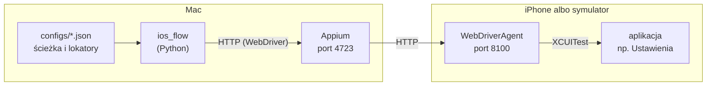

# Architektura

Jak polecenie z pliku JSON zamienia się w dotknięcie ekranu iPhone'a.
Wprowadzenie i instalacja: [README](../README.md).

## Łańcuch sterowania

Każda strzałka to inna warstwa — i inne miejsce, w którym coś może się
zepsuć.

| Element | Gdzie działa | Rola | Typowy problem |
|---|---|---|---|
| **Plik konfiguracyjny** | repozytorium | Jedyne miejsce z wiedzą o aplikacji: bundle ID, kroki, lokatory, pola do odczytu | Błędny lub brakujący lokator — walidacja i `inspect` |
| **ios_flow** | Mac, Python | Czyta konfigurację, otwiera sesję, wykonuje kroki, parsuje wynik, zapisuje JSON i zrzut ekranu | — |
| **Appium** | Mac, port 4723 | Serwer WebDriver; przyjmuje sesję z capabilities i przekazuje polecenia do drivera XCUITest | Nie działa / brak drivera — `connection_tips` w `driver.py` |
| **Driver XCUITest** | wewnątrz Appium | Buduje (przez `xcodebuild`), instaluje i uruchamia WebDriverAgent, tłumaczy polecenia WebDriver na wywołania WDA | `xcodebuild failed with code 65` — `showXcodeLog` |
| **WebDriverAgent** | urządzenie, port 8100 | Aplikacja testowa XCUITest działająca na urządzeniu; jedyny element, który czyta drzewo elementów i dotyka ekranu | Dwie instancje na jednym porcie — `socket hang up` |
| **Aplikacja** | urządzenie | Sterowana z zewnątrz; nie wie o automatyzacji, nie wymaga zmian ani kodu źródłowego | Animacje bez końca — `waitForQuiescence: false` |

### Dlaczego Mac

WebDriverAgent to projekt Xcode budowany narzędziem `xcodebuild`, które
działa tylko na macOS. Na symulatorze driver buduje WDA sam, bez
podpisywania. Na telefonie WDA musi być podpisane certyfikatem z konta
Apple Developer, bo iOS nie uruchomi niepodpisanej aplikacji.

### Symulator a telefon

Różnią się tylko capabilities (`ios_flow/driver.py::build_capabilities`):

- **symulator** — `deviceName` i `platformVersion` wskazują urządzenie
  z `xcrun simctl list devices`; bez podpisywania;
- **urządzenie** — `udid` wskazuje telefon, a `xcodeOrgId`,
  `xcodeSigningId`, `updatedWDABundleId` mówią driverowi, jak podpisać WDA.

Wszystko powyżej Appium działa w obu trybach identycznie.

## Przebieg jednego uruchomienia

`python -m ios_flow.run configs/przyklad-symulator.json`:

1. **Konfiguracja** (`config.py`) — wczytanie JSON-a, walidacja, budowa
   obiektów `Config`, `Step`, `FieldSpec`. Błąd tutaj kończy przebieg, zanim
   cokolwiek połączy się z Appium.
2. **Sesja** (`driver.py`) — capabilities dla trybu z konfiguracji,
   `webdriver.Remote` do Appium. Appium uruchamia WDA, a WDA aplikację.
3. **Restart aplikacji** — `terminate_app` + `activate_app`, żeby każdy
   przebieg zaczynał się z tego samego ekranu.
4. **Kroki** (`navigate.py`) — dla każdego kroku: lokator z konfiguracji →
   predykat iOS (`locators.py`) → czekanie do `czekaj_s` na element →
   dotknięcie → `pauza_s`. Brak elementu w kroku opcjonalnym pomija krok,
   w obowiązkowym przerywa przebieg z zapisem zrzutu i drzewa z chwili błędu.
5. **Odczyt** (`run.py::read_fields`) — czekanie na element każdego pola,
   pobranie atrybutu, wyciągnięcie wartości wzorcem (`extract.py`).
6. **Drzewo elementów** — `page_source` pobierane dopiero teraz, po
   znalezieniu elementów docelowych, więc zawiera także części ekranu,
   które ładowały się wolniej. Służy do diagnostyki (`teksty_na_ekranie`).
7. **Wynik** — zrzut ekranu i JSON w `artifacts/`, zamknięcie sesji.

W trybie `--lista` krok 5 zastępuje zbieranie listy: odczyt drzewa,
przewinięcie (`mobile: scroll`), znowu odczyt — aż dwa kolejne ekrany nie
dodadzą nowej pozycji. Wyniki kolejnych ekranów scalane są po nazwie,
w kolejności pierwszego wystąpienia.

## Podział modułów

| Moduł | Importuje z ios_flow | Appium/Selenium |
|---|---|---|
| `locators.py` | — | nie |
| `extract.py` | `locators` | nie |
| `navigate.py` | `locators` | nie |
| `config.py` | `extract`, `locators`, `navigate` | nie |
| `driver.py` | `config`, `locators`, `navigate` | tak, leniwie w `connect` i metodach sesji |
| `run.py` | `config`, `extract`, `locators`, `navigate`, `driver` | tak, leniwie |
| `inspect.py` | `extract`, `config`, `driver` | tylko przez `driver`, gdy nie użyto `--z-pliku` |

- `locators.py`, `extract.py`, `navigate.py`, `config.py` nie importują
  Appium ani Selenium. To w nich jest cała logika — i to ją sprawdzają testy
  na fiksturach.
- `navigate.py` szuka elementów przez protokół `Finder`: w przebiegu
  spełnia go sesja Appium, w testach atrapa `FakeDevice`, która przechodzi
  między zapisanymi drzewami XML.
- `driver.py` i `run.py` importują Appium dopiero w chwili łączenia.

## Drzewo elementów

WDA opisuje ekran jako XML (`page_source`). Każdy element ma typ
(`XCUIElementTypeButton`, `XCUIElementTypeStaticText`, `XCUIElementTypeCell`…)
i atrybuty:

| Atrybut | Co zawiera | Użycie w lokatorze |
|---|---|---|
| `name` | identyfikator dostępności (często nadany przez programistę) | `"typ": "id"` |
| `label` | tekst czytany przez VoiceOver; zależy od języka | `"typ": "etykieta"` |
| `value` | wartość pola, przełącznika, tekstu | odczyt (`"atrybut": "value"`) |
| `visible` | czy element jest na ekranie | filtr list i podglądu |

Głębokość czytanego drzewa ogranicza `snapshotMaxDepth`. Za mała wartość
daje drzewo z samych kontenerów.
